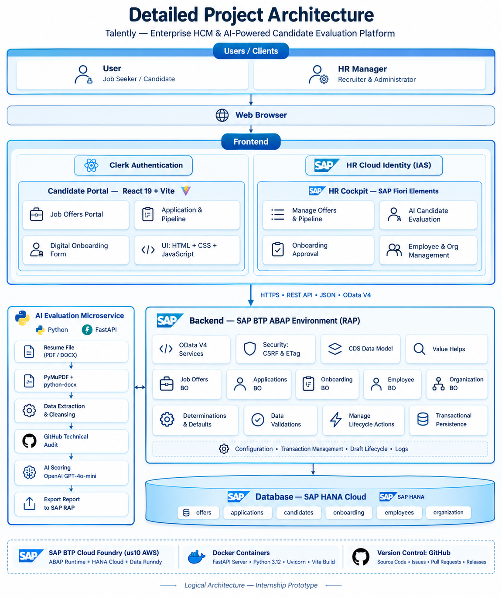
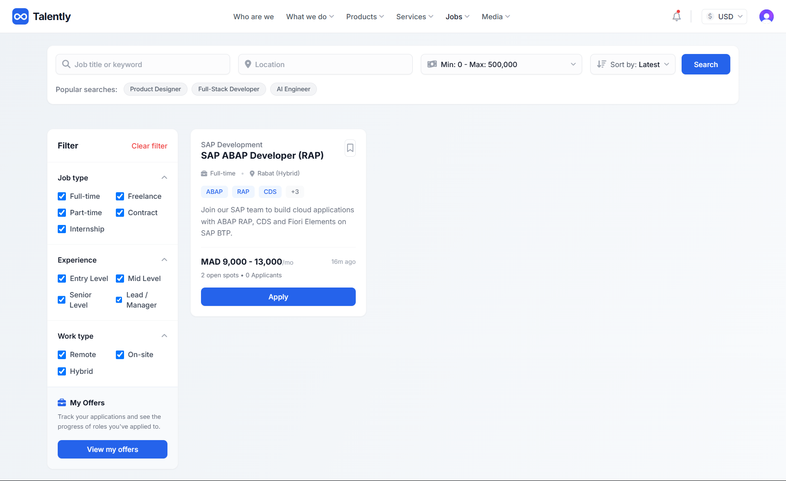
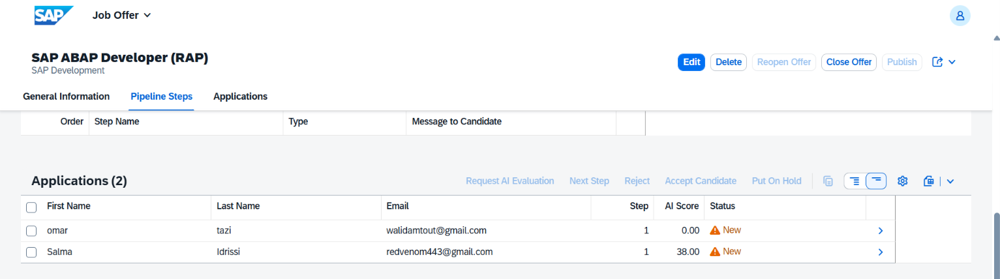
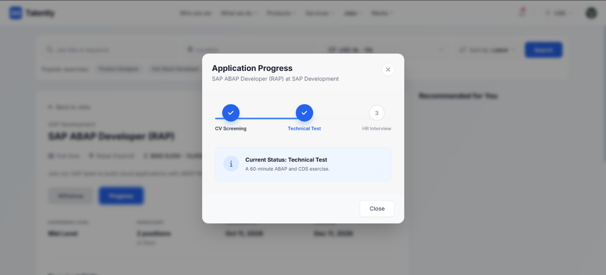
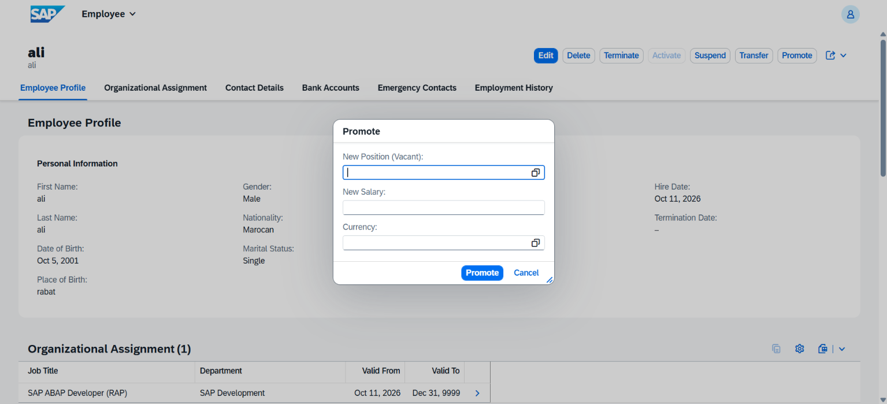

# Talently

**AI-assisted recruitment and employee administration platform built on SAP BTP with the ABAP RESTful Application Programming Model (RAP).**

Talently connects a modern candidate web portal to an SAP backend. HR teams model their organization, publish job offers, follow candidates through a configurable pipeline and, once a candidate is hired, create the employee record in SAP in a single transaction, without re-entering any data. Each resume is analyzed by an AI microservice that scores the candidate against a role rubric and explains its score, while the final decision stays with the recruiter.

The project was developed during an engineering internship at Cognitus (Tangier, Morocco), June to August 2026, as part of the ASEDS program of INPT (Rabat). The internship report and all its material are included in [`Talently_Report/`](Talently_Report/).



---

## Table of contents

- [Features](#features)
- [Architecture](#architecture)
- [Repository structure](#repository-structure)
- [Tech stack](#tech-stack)
- [Prerequisites](#prerequisites)
- [Getting started](#getting-started)
  - [1. RAP backend (SAP BTP)](#1-rap-backend-sap-btp)
  - [2. AI microservice](#2-ai-microservice)
  - [3. Candidate web portal](#3-candidate-web-portal)
- [Configuration](#configuration)
- [AI microservice API](#ai-microservice-api)
- [Backend services and business objects](#backend-services-and-business-objects)
- [Testing](#testing)
- [Measured results](#measured-results)
- [Screenshots](#screenshots)
- [Known limitations](#known-limitations)
- [Report and documentation](#report-and-documentation)
- [Author and acknowledgments](#author-and-acknowledgments)
- [License](#license)

---

## Features

**Organizational management (HR cockpit)**
- Hierarchy of organizational units with cost centers and budgets.
- Positions with full-time equivalent, budget and status (Vacant, Filled, Frozen).
- Integrity rules: a unit cannot be its own parent, and a unit that still has positions or sub-units cannot be deleted.

**Recruitment (HR cockpit)**
- Job offers edited in draft mode and linked to a vacant position.
- Configurable pipeline steps per offer, each with a message shown to the candidate.
- Lifecycle actions (publish, close, reopen) enabled according to the offer status. An offer cannot be published without at least one pipeline step.
- Application review: AI score and summary, next step, put on hold, reject (with reason), accept, HR notes, e-mail to the candidate.
- Candidates can only be accepted at the last pipeline step. Rejected candidates are added to a talent pool automatically.

**Candidate portal (React)**
- Public job board with search, filters and sorting.
- Sign-in and sign-up with Clerk (e-mail or social login).
- Application form with a resume link, and protection against duplicate applications.
- Real-time progress of each application through the pipeline, with withdrawal.
- Onboarding form (personal, legal, bank and emergency contact data) once accepted.

**AI resume analysis (FastAPI)**
- Reads PDF, Word, plain-text and Markdown resumes from a Google Drive link or a file upload.
- Parses the resume into the JSON Resume model with GPT-4o-mini (structured outputs).
- Enriches the profile with the candidate's GitHub repositories and README quality.
- Scores the candidate against a role rubric and the job offer, with evidence for each category.
- The language model judges, but the final score and recommendation are computed in Python.
- Personal identifiers (name, contact details, location, institution, grades) are never sent to the scoring model.

**Hiring and personnel administration (HR cockpit)**
- *Approve & Hire* creates the employee master record together with contact, bank, emergency contact, organizational assignment and history records, and marks the position as filled, all in one transaction.
- Employee lifecycle actions: promote, transfer, suspend, activate, terminate, recorded in the employment history.

---

## Architecture

```
            Candidate                                 HR manager
                |                                          |
                v                                          v
   +--------------------------+             +-----------------------------+
   |  Candidate web portal    |             |  HR cockpit                 |
   |  React 19 + Vite, Clerk  |             |  SAP Fiori Elements, IAS    |
   +--------------------------+             +-----------------------------+
        |               |                                  |
        | REST          | OData V4 (/sap-api proxy)        | OData V4
        v               v                                  v
   +-----------------+  +--------------------------------------------------+
   | AI microservice |  |  SAP BTP ABAP Environment - RAP backend          |
   | Python, FastAPI |  |  CDS view entities, behavior definitions,        |
   | GPT-4o-mini,    |  |  OData V4 services, ABAP Unit tests              |
   | GitHub API      |  +--------------------------------------------------+
   +-----------------+                          |
                                                v
                                       SAP HANA Cloud
```

1. A candidate applies on the portal. The application is created in SAP by the RAP action `applyToJob`.
2. In the background, the portal sends the resume link and the offer text to the AI microservice.
3. The portal writes the score, recommendation and summary back to SAP with the RAP action `setAIEvaluation`.
4. The recruiter reviews the candidates in the Fiori cockpit and moves them through the pipeline.
5. The accepted candidate fills in the onboarding form on the portal, and HR approval creates the employee.

The backend follows SAP's Clean Core approach: it is a side-by-side extension written in ABAP for Cloud Development with released APIs only, and no SAP standard object is modified.

---

## Repository structure

```
.
├── Talently/                     Source code
│   ├── rap-backend/              SAP RAP backend (abapGit format)
│   │   └── src/                  Tables, CDS views, behaviors, classes, services
│   ├── ai-microservice/          FastAPI resume evaluation service
│   │   ├── converters/           PDF, DOCX, TXT readers and Google Drive fetcher
│   │   ├── core/                 Settings, LLM client, prompt templates
│   │   ├── data/                 Resume-to-text transformation
│   │   ├── models/               Pydantic request, response and resume models
│   │   ├── prompts/templates/    Jinja2 prompts for the parsing steps
│   │   ├── roles/                Scoring rubrics (software_engineering_intern)
│   │   ├── routers/              /health, /roles, /evaluate/* endpoints
│   │   ├── services/             Parser, GitHub enricher, scoring engine
│   │   ├── tests/                pytest suite
│   │   ├── Dockerfile
│   │   └── docker-compose.yml
│   ├── web-portal/               React candidate portal
│   │   ├── src/                  Pages, components, SAP and AI API client
│   │   └── vite.config.js        Dev server with the /sap-api proxy
│   └── .gitignore
├── Talently_Report/              Internship report and project material
└── .abapgit.xml                  abapGit settings (starting folder /Talently/rap-backend/src/)
```

---

## Tech stack

| Layer | Technologies |
|---|---|
| Backend | SAP BTP ABAP Environment, ABAP RAP (managed, draft, strict mode 2), CDS view entities, OData V4, ABAP Unit |
| HR cockpit | SAP Fiori Elements (List Report and Object Page), SAP Cloud Identity Services (IAS) |
| Database | SAP HANA Cloud |
| AI service | Python 3.11+, FastAPI, Pydantic, OpenAI GPT-4o-mini, PyMuPDF, python-docx, Jinja2, GitHub REST API, pytest, Docker |
| Candidate portal | React 19, Vite, React Router, Tailwind CSS, Axios, Clerk |
| Tooling | Eclipse ABAP Development Tools (ADT), abapGit, Git and GitHub |

---

## Prerequisites

- An **SAP BTP ABAP Environment** system (the free SAP BTP trial works) and **Eclipse with ABAP Development Tools** and the **abapGit for ADT** plug-in.
- **Python 3.11** or later.
- **Node.js 20.19+ or 22.12+** (required by Vite) and npm.
- An **OpenAI API key** (the evaluation uses GPT-4o-mini; one resume costs about 0.003 USD).
- A **Clerk** application (free plan) for candidate authentication.
- Optional: a **GitHub personal access token**, to avoid the GitHub API rate limit, and **Docker**.

---

## Getting started

Clone the repository:

```bash
git clone <repository-url>
cd <repository-folder>/Talently
```

Set up the three parts in this order: backend, AI microservice, portal.

### 1. RAP backend (SAP BTP)

The backend is stored in abapGit format in `Talently/rap-backend/src`. The `.abapgit.xml` file at the root of the repository points abapGit to this folder, so the repository can be linked directly.

1. In ADT, create a package for the project (for example `ZHR_TALENTLY`) in your ABAP Environment project.
2. In the *abapGit Repositories* view of ADT, choose *Link abapGit Repository*, enter the URL of this repository and the branch `main`, and select your package.
3. Pull the repository and **activate** all objects (*Activate inactive objects*).
4. Open the service bindings `ZUI_HCM_RECRUIT`, `ZUI_HCM_PA` and `ZUI_HCM_ORG` and click **Publish** if they are not published yet.
5. Run the class `ZCL_HCM_POPULATE_STATUS` with **F9** (*Run as ABAP Application (Console)*). It fills the status and lookup texts and can be run several times safely.
6. Optional: run `ZCL_HCM_GENERATE_MOCK_DATA` to create demo job offers and candidates. **This class deletes the existing recruitment data first**, so run it only on an empty or test system, and run `ZCL_HCM_POPULATE_STATUS` again afterwards.
7. Open the HR cockpit from each service binding with *Preview* (Fiori Elements), or add the apps to a Fiori launchpad.

The Web API `ZAPI_HCM_RECRUIT` and its communication scenario are included for integrations with external systems.

### 2. AI microservice

```bash
cd ai-microservice
python -m venv .venv
# Windows: .venv\Scripts\activate    macOS/Linux: source .venv/bin/activate
pip install -r requirements.txt

cp .env.example .env               # then set OPENAI_API_KEY (and GITHUB_TOKEN)
uvicorn main:app --host 0.0.0.0 --port 8000 --reload
```

The interactive API documentation is available at <http://localhost:8000/docs>, and a health check at <http://localhost:8000/health>.

With Docker:

```bash
cd ai-microservice
cp .env.example .env               # then set OPENAI_API_KEY
touch evaluations.csv              # mounted by docker-compose for the CSV export
docker compose up --build
```

### 3. Candidate web portal

```bash
cd web-portal
npm install
cp .env.example .env               # then fill in the values below
npm run dev
```

The portal runs at <http://localhost:5173>.

During development, the portal reaches SAP through the Vite proxy `/sap-api`, which forwards the requests to your SAP system with an SAP session cookie:

1. Set `SAP_API_TARGET` to the URL of your ABAP Environment, for example `https://<system-id>.abap-web.us10.hana.ondemand.com`.
2. Open any Fiori preview of the system in your browser and sign in.
3. Copy the value of the `Cookie` request header from the browser developer tools (*Network* tab, any request to the system) into `SAP_COOKIE`.
4. Restart `npm run dev`.

SAP sessions expire after some time. When the portal stops loading data, copy a fresh cookie into `.env`. The cookie stays on the development server and is never included in the browser bundle.

Available scripts:

| Command | Description |
|---|---|
| `npm run dev` | Start the development server with the SAP proxy |
| `npm run build` | Build the production bundle into `dist/` |
| `npm run preview` | Preview the production build |
| `npm run lint` | Lint the code with oxlint |

---

## Configuration

Both services read their settings from a `.env` file. Copy the provided `.env.example` and fill it in. `.env` files are ignored by Git.

**`ai-microservice/.env`**

| Variable | Required | Default | Description |
|---|---|---|---|
| `OPENAI_API_KEY` | Yes | | OpenAI API key |
| `GITHUB_TOKEN` | No | | GitHub token, raises the API rate limit for the GitHub enrichment |
| `DEFAULT_MODEL` | No | `gpt-4o-mini` | Model used for parsing and scoring |
| `DEFAULT_ROLE` | No | `software_engineering_intern` | Rubric used when the request gives no role |
| `HOST` / `PORT` | No | `0.0.0.0` / `8000` | Server address |
| `ENVIRONMENT` | No | `development` | Environment name |
| `LOG_LEVEL` | No | `INFO` | Logging level |
| `CSV_EXPORT_PATH` | No | `evaluations.csv` | File used by `/evaluate/csv` |

**`web-portal/.env`**

| Variable | Required | Description |
|---|---|---|
| `VITE_CLERK_PUBLISHABLE_KEY` | Yes | Publishable key of your Clerk application |
| `VITE_AI_API_URL` | No | URL of the AI microservice (default `http://localhost:8000`) |
| `SAP_API_TARGET` | Yes | URL of the SAP BTP ABAP Environment system |
| `SAP_COOKIE` | Yes | SAP session cookie used by the development proxy |

---

## AI microservice API

| Method | Endpoint | Description |
|---|---|---|
| `GET` | `/health` | Service status |
| `GET` | `/roles` | Available scoring roles |
| `POST` | `/evaluate/score` | Concise score and recommendation (used by the portal) |
| `POST` | `/evaluate/full` | Full breakdown: categories, evidence, bonus, deductions, GitHub analysis |
| `POST` | `/evaluate/csv` | Full evaluation, also appended to the CSV export |
| `POST` | `/evaluate/upload` | Evaluation of an uploaded file (multipart) |

Example request:

```bash
curl -X POST http://localhost:8000/evaluate/score \
  -H "Content-Type: application/json" \
  -d '{
        "gdrive_url": "https://drive.google.com/file/d/<file-id>/view",
        "offer_info": "SAP ABAP Developer (RAP). Skills: ABAP, CDS, RAP, OData, Fiori Elements."
      }'
```

The resume must be shared with *Anyone with the link*. The optional fields are `github_url` (otherwise detected from the resume), `role` and `model_name`.

Example response:

```json
{
  "status": "success",
  "candidate_name": "Salma Idrissi",
  "score": 38.0,
  "max_score": 100.0,
  "percentage": 38.0,
  "recommendation": "DO_NOT_HIRE",
  "role": "software_engineering_intern",
  "key_strengths": ["..."],
  "areas_for_improvement": ["..."]
}
```

**Scoring rubric** (`roles/software_engineering_intern`)

| Category | Points |
|---|---|
| Open source contributions | 0 to 35 |
| Personal projects | 0 to 30 |
| Production experience | 0 to 25 |
| Technical skills | 0 to 10 |
| Bonus (e.g. Google Summer of Code, startup experience, portfolio) | up to +20 |
| Deductions (e.g. tutorial-only projects, missing links or README) | variable |

Recommendation: `STRONG_HIRE` from 80 %, `HIRE` from 65 %, `CONSIDER` from 50 %, otherwise `DO_NOT_HIRE`. New roles can be added as folders under `roles/`.

---

## Backend services and business objects

**Service bindings (OData V4)**

| Binding | Type | Used by |
|---|---|---|
| `ZUI_HCM_RECRUIT` | UI | Job offers, applications, onboarding and talent pool apps, and the candidate portal |
| `ZUI_HCM_PA` | UI | Personnel administration app |
| `ZUI_HCM_ORG` | UI | Organizational management app |
| `ZAPI_HCM_RECRUIT` | Web API | External integrations (communication scenario `ZCS_HCM_RECRUIT`) |

**Business objects**

| Root entity | Child entities | Draft |
|---|---|---|
| `ZI_HCM_OrgUnit` | `ZI_HCM_Position` | Yes |
| `ZI_HCM_JobOffer` | `ZI_HCM_PipeTmpl`, `ZI_HCM_Application`, `ZI_HCM_PipeProg` | Yes |
| `ZI_HCM_Candidate` | | No |
| `ZI_HCM_Onboarding` | | Yes |
| `ZI_HCM_Employee` | `ZI_HCM_Contact`, `ZI_HCM_BankDetl`, `ZI_HCM_Emergency`, `ZI_HCM_OrgAssign` | Yes |
| `ZI_HCM_TalentPool` | | No |

**Main actions**

| Action | Effect |
|---|---|
| `publishOffer`, `closeOffer`, `reopenOffer` | Job offer lifecycle |
| `applyToJob` | Creates an application at the first pipeline step |
| `evaluateWithAI`, `setAIEvaluation` | Requests a new AI evaluation, stores the AI result |
| `passToNextStep`, `putOnHold`, `rejectCandidate`, `acceptToPost` | Pipeline decisions |
| `addNote`, `sendMail` | HR notes and e-mail to the candidate |
| `submitForm`, `approveAndCreateEmployee`, `rejectForm` | Onboarding review and hiring |
| `promoteEmployee`, `transferEmployee`, `suspendEmployee`, `activateEmployee`, `terminateEmployee` | Personnel events |

Every write is protected by a CSRF token and an ETag (`If-Match`), and the actions are enabled per instance through feature control.

---

## Testing

**AI microservice** (19 tests, no network access needed):

```bash
cd ai-microservice
python -m pytest tests -v
```

**RAP backend**: open the test class `ZCL_HCM_RAP_TEST` in ADT and run it with *Run As > ABAP Unit Test* (Ctrl+Shift+F10). The four tests run against test doubles, so they do not change the data of the system:

- an offer cannot be published without pipeline steps;
- a candidate cannot apply twice to the same offer;
- an offer is closed when all its positions are filled;
- hiring creates the employee with all its child records.

---

## Measured results

Measured on the SAP BTP trial system (October 2026):

| Operation | Average time |
|---|---|
| Loading the job offers list | 226 ms |
| Submitting an application (`applyToJob`) | 306 ms |
| Hiring (`approveAndCreateEmployee`) | 428 ms |
| AI evaluation of one resume, end to end (in the background) | 64.7 s |

Evaluation of the AI engine on fictitious resumes (70 runs):

- three profiles of known level were ranked in the expected order in every run (61.7, 44.7 and 0.0 out of 100);
- the resume format (PDF, DOCX, TXT) changed the mean score by at most 5 points;
- the same resume evaluated 10 times gave 47.5 on average, with a standard deviation of 6.0;
- after the scoring input was anonymized, the score difference between two resumes that differ only in name, gender, city and university was no longer significant.

The test resumes, raw measurements and scripts are in [`Talently_Report/10_Tests_and_Results`](Talently_Report/10_Tests_and_Results).

---

## Screenshots

| Candidate portal: job board | HR cockpit: applications with AI scores |
|---|---|
|  |  |

| Candidate portal: application progress | HR cockpit: employee and promotion |
|---|---|
|  |  |

All screenshots of the end-to-end scenario are in [`Talently_Report/09_UI_Screenshots`](Talently_Report/09_UI_Screenshots).

---

## Known limitations

- The portal reaches SAP through a **development proxy** with a session cookie, which suits the SAP BTP trial account. A production setup should call the Web API `ZAPI_HCM_RECRUIT` through its communication arrangement from a server-side component.
- The AI score is stable but **not fully deterministic**: the open source category can vary between runs on the same evidence.
- Only one scoring rubric is provided (`software_engineering_intern`), and the engine was tested on a small set of fictitious resumes.
- Resumes are read from **public Google Drive links**, which is practical for a prototype but not suited to personal data in production.
- The employees are created in the custom tables of the extension; they are not replicated to SAP S/4HANA or SAP SuccessFactors.

---

## Report and documentation

[`Talently_Report/`](Talently_Report/) contains the internship report and the project material:

| Folder | Content |
|---|---|
| `01_Report_PDF` | Internship report (PDF) |
| `02_LaTeX_Source` | LaTeX source of the report |
| `03_Excel` | Project charter and software development plan |
| `04_Gantt` | GanttProject schedule and Gantt diagram |
| `05_Scrum_Planning` | Scrum framework and sprint plan |
| `06_UML_Diagrams` | Use case, class and sequence diagrams (images and sources) |
| `07_Architecture_Diagrams` | Global, backend and AI engine architecture |
| `08_UI_Mockups` | Mockups of the portal and the HR cockpit |
| `09_UI_Screenshots` | Screenshots of the end-to-end scenario |
| `10_Tests_and_Results` | Unit test runs, measurements, test resumes |
| `11_SAP_Learning` | SAP Learning courses completed for the project |
| `12_Logos_and_Company` | Logos and company figures used in the report |

---

## Author and acknowledgments

**Oualid AMTOUT**, engineering student, Advanced Software Engineering for Digital Services (ASEDS), Institut National des Postes et Télécommunications (INPT), Rabat.

Developed during an internship at **Cognitus** (an IBM company), Global Delivery and Support Center, Tangier, under the supervision of **Mr. Karim Aït Alla**, Technical Lead. Thanks to the Cognitus team in Tangier for their support.

---

## License

No license has been chosen for this project yet, so all rights are reserved by the author. Contact the author before reusing the code.
